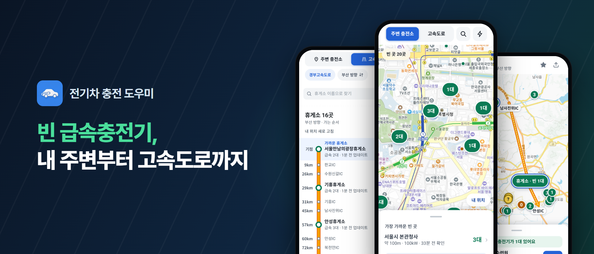
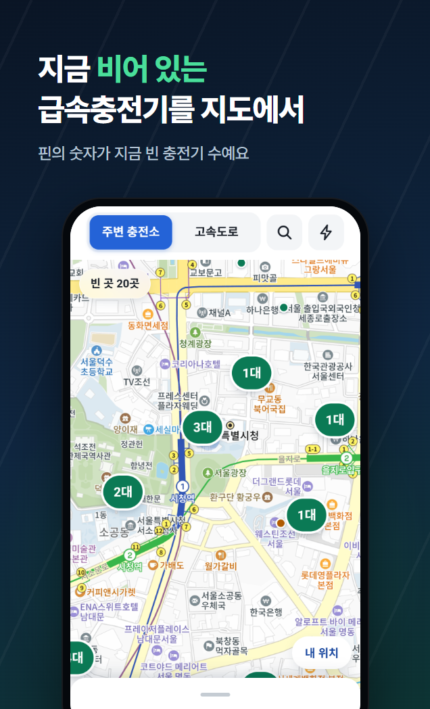
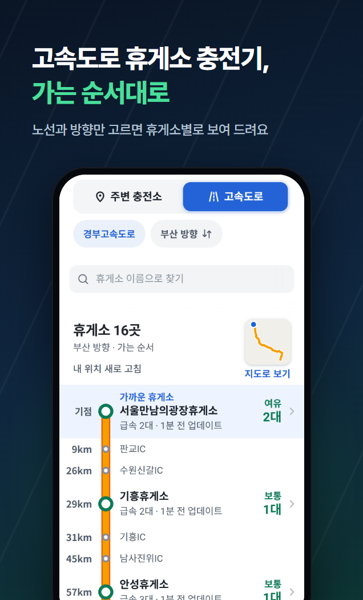
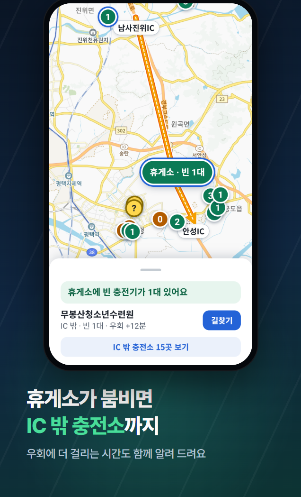

# ⚡ ChargeFlow — 고속도로 충전 도우미



> **휴게소 급속충전기가 꽉 찼을 때, 기다릴지 우회할지 알려 주는 전기차 운전자용 미니앱**

**토스 앱인토스(Apps in Toss) 출시 · 자동차 카테고리 9위 · DAU 15 → 50명 (최고 77명)** · 개인 기획·개발·운영

휴게소의 급속충전기가 모두 사용 중일 때, 무작정 기다리지 않고 **이전/다음 IC 인근의 대체 충전소**로 우회할지 판단할 수 있도록 실시간 혼잡도·예상 대기 시간·우회 추가 시간을 안내합니다.

<p align="center">
  
  
  
</p>

## 한눈에 보기

| | |
|---|---|
| **문제** | 고속도로 휴게소 급속충전기는 수가 적고 40분 이용 제한이 있어, 도착해서야 만석을 알게 되고 기다릴지 떠날지 판단할 근거가 없다 |
| **해결** | 환경부 실시간 충전기 상태로 혼잡도를 판정하고, 예상 대기 시간과 우회 추가 시간(IC 왕복 + 진출입)을 나란히 비교 |
| **범위** | 전국 12개 고속도로 노선의 휴게소와 IC 인근 대체 충전소 |
| **운영** | 공공데이터 개발계정 한도(1,000회/일) 안에서 5~10분 주기 증분 폴링으로 전국 상태 갱신 |
| **스택** | Django · DRF · PostgreSQL · React · TypeScript · Vite · TDS · Railway |

---

## ✨ 주요 기능

| 기능 | 내용 |
|---|---|
| 내 주변 빈 급속충전소 | 앱을 열면(`/`) 현재 위치로 지도와 가까운 순 목록을 보여줌. 전국 50kW 이상 급속충전소 중 빈 충전기가 있는 곳만 5→10→20→30km 순으로 넓혀 찾음. 위치를 거부하면 지역 선택. 갱신이 24시간 넘게 없으면 빈 충전기로 세지 않고, 개수는 공공데이터 기반 "참고용". 이용 제한(`limitYn=Y`)·아파트 단지·삭제·고속도로 휴게소 충전소는 제외 |
| 실시간 혼잡도 | 휴게소 충전기의 빈 충전기 비율로 여유/보통/혼잡/만석/이용 불가 판정. 30분 넘게 갱신이 없으면 "정보 없음" |
| 기다릴까, 우회할까 | 만석이면 충전 시작 시각과 휴게소 40분 제한으로 예상 대기 시간을 추정하고, 우회 충전소의 추가 시간(IC 왕복+진출입)과 비교 |
| 우회 충전소 실시간 | IC 근처 대체 충전소에도 빈 충전기 수를 표시 (환경부 실시간 상태) |
| 내 차 커넥터 | DC콤보·차데모·AC3상·NACS 중 고르면 맞는 충전소만 표시 |
| 가는 방향 휴게소 | 위치를 두 번 재서 진행 방향을 구하고, 앞으로 지날 같은 방향 휴게소만 거리순 표시 |
| 혼잡 패턴·예측 | 요일·시간대별 혼잡 이력을 쌓아 평소 패턴과 1·2시간 뒤 혼잡 가능성(통계 예측) 표시 |
| 구간 모드 | 출발·도착을 고르면 지날 휴게소와 도착 무렵 혼잡 예측을 순서대로 표시 |
| 알림 | 빈자리 알림(1회성, 6시간 유효), 즐겨찾기 휴게소 상태 알림(혼잡해질 때·풀릴 때, 2시간 간격) |
| 노선 | 경부·서해안·영동 + 중부·통영대전, 호남, 남해, 중부내륙, 중앙, 서울양양, 광주대구, 평택제천, 순천완주 (12개) |

---

## 🧰 기술 스택

| 구분 | 사용 기술 |
|---|---|
| Backend | Python, Django 4.2, Django REST Framework, gunicorn, WhiteNoise |
| DB | PostgreSQL (Railway), 로컬은 SQLite |
| Frontend | React 18, TypeScript, Vite, TDS(Toss Design System), `@apps-in-toss/web-framework` |
| 데이터 | 공공데이터포털 한국환경공단 전기자동차 충전소 API, Kakao API |
| 알림 | 앱인토스 메시지 발송 (mTLS) |
| 배포 | Railway (web + cron 서비스) |

---

## 🛠️ 구조

```
chargeflow/
├── config/                         # Django 설정 (CORS: TOSS_APP_NAME 기준 tossmini 도메인)
├── chargeflow/
│   ├── models.py                   # 노선·노드·충전소 / 충전기 상태·혼잡도·혼잡 패턴 / 사용자 설정·즐겨찾기·알림 / 전국 급속충전소(PublicStation)
│   ├── views.py                    # REST API (/api/v1/...)
│   ├── services/
│   │   ├── ev_api.py               # 환경부 충전기 API 클라이언트
│   │   ├── public_catalog.py       # 전국 급속충전소 분류·저장, 갱신 현황 보고
│   │   ├── nearby.py               # 주변 검색(반경 5→10→20→30km), 빈 충전기 판정(24시간 규칙)
│   │   ├── congestion.py           # 혼잡도 계산, 패턴 기록·예측, 대기 추정
│   │   └── toss_notify.py          # 앱인토스 메시지 발송 (mTLS)
│   └── management/commands/
│       ├── poll_charger_status.py  # 상태 폴링 워커 (Procfile worker)
│       ├── sync_public_stations.py # 전국 급속충전소 스캔 (하루 1회 크론)
│       └── build_catalog.py        # 신규 노선 구축 + 충전소 정보 보강 (로컬에서 실행 후 fixture 갱신)
├── frontend/                       # 앱인토스 미니앱 (React + TDS + @apps-in-toss/web-framework)
│   └── src/pages/NearbyPage.tsx    # 홈(/): 내 주변 지도·목록 (고속도로 홈은 /highways)
├── templates/index.html            # 구버전 화면 (새 번들 출시 전까지 유지)
└── chargeflow_data.json            # 노선·노드·충전소 fixture (배포 때마다 loaddata)
```

### 충전기 상태 폴링
- 증분: `getChargerStatus(period=주기+1분)`로 최근 상태를 보고한 전국 충전기를 받아 추적 중인 충전소만 반영 (주기당 1회 내외)
- 기준선: 하루 1회 `getChargerInfo(kindDetail=C001)` 1회 + 빠진 휴게소 충전소만 statId로 보충. 실행 간격이 10분을 넘겨 공백이 생기면 C001 1회만 다시 받음
- 호출량: 10분 간격 하루 약 450회, 5분 간격 약 600회 → 공공데이터 개발계정 한도(1,000회/일) 안

### 주변 급속충전소 데이터
- 전국 급속(50kW 이상) 충전소는 fixture로 싣는 `ChargingStation`과 별도의 `PublicStation`에 저장 (2026-11-19 실측: 충전소 19,293곳·충전기 39,478기)
- `sync_public_stations`: `ev_api.PUBLIC_ZCODES`(고속도로용 17개 시도 + 제주 50)를 지역별로 스캔하고 각 지역을 최대 3번까지 시도(`REGION_ATTEMPTS`). 더 이상 보이지 않는 충전소는 모든 지역 스캔이 성공했을 때만 비활성화
- 스캔 결과가 너무 적어 보이면(전체 또는 어느 한 지역이 기존 활성 충전소의 절반 미만) 아무것도 비활성화하지 않고 오류로 끝남
- 옵션 `--zcodes`(일부 지역), `--report-only`(API 호출 없이 현황만), `--api-key`
- `poll_charger_status`는 전국 급속 충전기의 상태도 갱신하지만 새로 만들지는 않음
- API: `POST /api/v1/stations/nearby/` — 좌표는 URL이 아니라 JSON 본문으로 보내며 저장·기록하지 않음

---

## 🚀 로컬 실행

```bash
python -m venv .venv && .venv\Scripts\activate
pip install -r requirements.txt
python manage.py migrate
python manage.py loaddata chargeflow_data.json
python manage.py runserver 8000

# 실시간 상태 (PUBLIC_DATA_API_KEY 필요)
python manage.py poll_charger_status            # 1회
python manage.py poll_charger_status --loop     # 상주
python manage.py sync_public_stations --zcodes 41   # 주변 충전소 로컬 데이터 (경기 1곳만)

# 프론트 (브라우저 개발: devtools가 앱인토스 SDK를 mock)
cd frontend
echo VITE_API_BASE_URL=http://localhost:8000 > .env.development.local
npm install && npm run dev
npm run build                                   # frontend.ait 생성
```

테스트: `python manage.py test chargeflow`, `npm --prefix frontend test`

환경 변수는 [.env.example](.env.example)을 참고하세요.

---

## ☁️ 배포 (Railway)

- `web`: migrate → collectstatic → loaddata → gunicorn
- `chargeflow-cron` 서비스: 크론 `*/10 * * * *`(5분도 가능), 시작 명령 `python manage.py poll_charger_status` (1회 실행·조회 범위 10분)
  (상주 워커를 쓰는 환경이면 `poll_charger_status --loop`)
- `chargeflow-catalog-cron` 서비스: 크론 `0 19 * * *`(UTC, 한국 시각 04시), 시작 명령 `python manage.py sync_public_stations`
  - 첫 배포 뒤 이 명령을 한 번 수동 실행해야 합니다. 안 하면 지도가 비어 있습니다.
  - 호출량: 스캔 약 60회/일 + 폴러 약 450회/일 → 한도(1,000회/일) 안
- 세 서비스 모두 `PUBLIC_DATA_API_KEY`, `DATABASE_URL`이 필요하고, web에는 `TOSS_APP_NAME`(CORS)을 설정
- 알림 발송은 `TOSS_MTLS_CERT`·`TOSS_MTLS_KEY`와 콘솔에서 승인된 템플릿 코드가 있을 때만 동작

### 노선·충전소 데이터 갱신
`build_catalog`는 로컬에서 실행하고 결과를 fixture로 저장해 배포합니다. 이미 배포된 노선은 `--rebuild` 없이 다시 만들지 않습니다(노드 id가 바뀌면 즐겨찾기가 끊기기 때문).

```bash
python manage.py build_catalog                  # 전국 충전기 스캔(약 60회 호출) 포함
python manage.py dumpdata chargeflow.highway chargeflow.highwaynode chargeflow.chargingstation \
  chargeflow.nodestationmapping chargeflow.highwaynodecharger --indent 2 -o chargeflow_data.json
```
