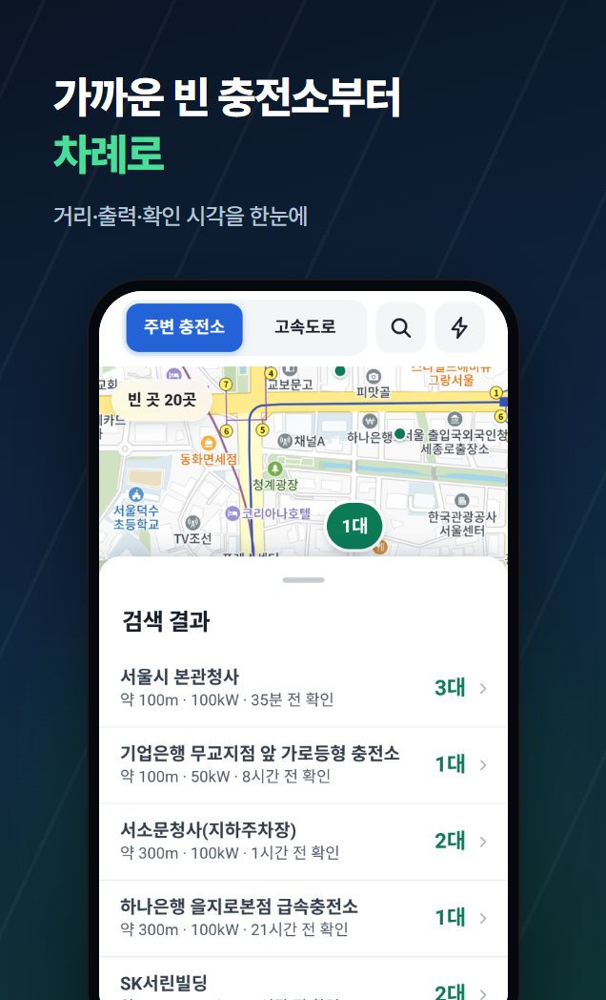
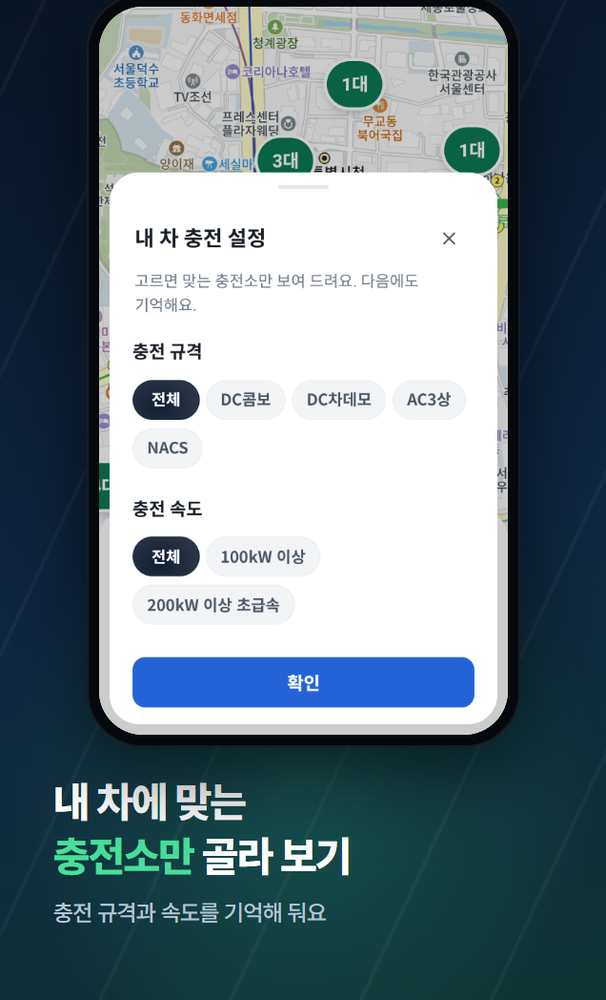

# ChargeFlow — 전기차 충전 도우미


> **지금 비어 있는 주변 급속충전기를 찾고, 고속도로에서는 휴게소 충전과 IC 밖 우회를 비교하는 앱인토스 미니앱**

**토스 앱인토스(Apps in Toss) 출시** · 개인 기획·개발·운영

일상에서는 주소·장소 또는 내 위치를 기준으로 빈 충전기 수를 확인하고 길찾기를 열 수 있습니다. 고속도로에서는 노선과 방향을 골라 휴게소의 충전 상태를 확인하고, 만석일 때 예상 대기 시간과 주변 IC로 우회하는 데 드는 추가 시간을 비교할 수 있습니다.

## 앱 화면

### 주변 급속충전소

<p align="center">
  
  
  
</p>

### 고속도로 휴게소

<p align="center">
  
  
</p>

## 한눈에 보기

| | |
|---|---|
| **주변 충전** | 전국 50kW 이상 공개 급속충전소를 지도와 가까운 순 목록에서 확인 |
| **고속도로 충전** | 12개 노선의 휴게소와 IC 인근 대체 충전소에서 현재 충전 상태와 우회 추가 시간을 비교 |
| **UI** | 앱인토스 TDS와 블루 테마(`#2463D7`)를 적용하고, 지도에서는 숫자 핀과 하단 시트로 정보를 표시 |
| **운영** | 공공데이터 개발계정 한도(1,000회/일) 안에서 5~10분 주기 증분 폴링으로 전국 상태 갱신 |
| **스택** | Django · DRF · PostgreSQL · React · TypeScript · Vite · TDS · Railway |

---

## 주요 화면

| 화면 | 동작 |
|---|---|
| **주변 충전소** (`/`) | 지도 핀 숫자는 빈 충전기 수입니다. 아래 시트를 펼치면 가까운 순 목록과 충전소 상세를 볼 수 있습니다. 돋보기에서 주소·장소를 검색하거나 시·도를 고를 수 있습니다. |
| **충전 설정** | 홈의 충전 설정 시트에서 DC콤보·DC차데모·AC3상·NACS와 충전 속도(전체·100kW 이상·200kW 이상)를 고릅니다. 최소 출력은 현재 기기에 저장합니다. |
| **고속도로** (`/highways`, `/highway/:code`) | 노선과 방향을 선택하면 휴게소·IC를 가는 순서대로 배치한 노선 띠가 열립니다. 작은 지도를 눌러 지도 보기로 전환할 수 있습니다. 위치가 휴게소에서 20km 이내면 노선을 자동으로 선택할 수 있고, 최근 이동 방향이 확인될 때만 다음 휴게소를 표시합니다. |
| **휴게소 상세** (`/rest-area/:id`) | 지도와 접힌 시트에서 휴게소 충전 상태, 추천 충전소의 빈 대수·우회 추가 시간, 길찾기를 확인합니다. 시트를 펼치면 IC별 대체 충전소와 필터, 데이터가 있는 경우 요일별 혼잡 패턴을 볼 수 있습니다. 즐겨찾기와 공유도 제공합니다. |
| **구간 미리 보기** (`/trip`) | 노선·방향·출발·도착을 고르면 구간 거리, 지날 휴게소, 시속 90km 기준 예상 도착 소요 시간을 보여 줍니다. |

처음에는 주소·장소 검색과 지역 선택을 바로 사용할 수 있습니다. 이전 위치가 있으면 해당 위치의 결과부터 불러오고, 권한 창은 사용자가 내 위치 버튼을 누를 때만 요청합니다. 지도 로딩에 실패하거나 화면 높이가 560px 미만이면 목록형 화면을 사용할 수 있습니다.

GitHub `main`에 병합된 화면 개편은 [주변 충전소 검색](https://github.com/cen04088/ChargeFlow/pull/1), [지도와 하단 시트](https://github.com/cen04088/ChargeFlow/pull/2), [주소 검색과 충전 설정](https://github.com/cen04088/ChargeFlow/pull/3)에서 확인할 수 있습니다. 첫 진입 개선과 로딩 제한은 [현재 작업 브랜치](https://github.com/cen04088/ChargeFlow/tree/feat/nearby-sheet-design) 기준입니다.

---

## 🧰 기술 스택

| 구분 | 사용 기술 |
|---|---|
| Backend | Python, Django 4.2, Django REST Framework, gunicorn, WhiteNoise |
| DB | PostgreSQL (Railway), 로컬은 SQLite |
| Frontend | React 18, TypeScript, Vite, TDS(Toss Design System), `@apps-in-toss/web-framework` |
| 데이터 | 공공데이터포털 한국환경공단 전기자동차 충전소 API, 카카오맵 JavaScript SDK와 장소 검색 |
| 알림 | 앱인토스 메시지 발송 (mTLS) |
| 배포 | Railway (web + cron 서비스) |

---

## 🛠️ 구조

```
chargeflow/
├── config/                         # Django 설정 (CORS: TOSS_APP_NAME 기준 tossmini 도메인)
├── chargeflow/
│   ├── models.py                   # 노선·노드·충전소 / 충전기 상태·혼잡도·혼잡 패턴 / 사용자 설정·즐겨찾기·알림 / 전국 급속충전소(PublicStation)
│   ├── views.py                    # REST API (/api/v1/...)
│   ├── services/
│   │   ├── ev_api.py               # 환경부 충전기 API 클라이언트
│   │   ├── public_catalog.py       # 전국 급속충전소 분류·저장, 갱신 현황 보고
│   │   ├── nearby.py               # 주변 검색(반경 5→10→20→30km), 빈 충전기 판정(24시간 규칙)
│   │   ├── congestion.py           # 혼잡도 계산, 패턴 기록·예측, 대기 추정
│   │   └── toss_notify.py          # 앱인토스 메시지 발송 (mTLS)
│   └── management/commands/
│       ├── poll_charger_status.py  # 충전기 상태 폴링 (크론 또는 상주 실행)
│       ├── sync_public_stations.py # 전국 급속충전소 스캔 (하루 1회 크론)
│       └── build_catalog.py        # 신규 노선 구축 + 충전소 정보 보강 (로컬에서 실행 후 fixture 갱신)
├── frontend/                       # 앱인토스 미니앱 (React + TDS + @apps-in-toss/web-framework)
│   ├── src/pages/                  # 주변 충전소·고속도로·휴게소·구간 미리 보기
│   └── src/components/             # 지도·노선 띠·검색·하단 시트
├── templates/index.html            # Django가 제공하는 기존 웹 화면
└── chargeflow_data.json            # 노선·노드·충전소 fixture (배포 때마다 loaddata)
```

### 충전기 상태 폴링
- 증분: `getChargerStatus(period=주기+1분)`로 최근 상태를 보고한 전국 충전기를 받아 추적 중인 충전소만 반영 (주기당 1회 내외)
- 기준선: 하루 1회 `getChargerInfo(kindDetail=C001)` 1회 + 빠진 휴게소 충전소만 statId로 보충. 실행 간격이 10분을 넘겨 공백이 생기면 C001 1회만 다시 받음
- 호출량: 10분 간격 하루 약 450회, 5분 간격 약 600회 → 공공데이터 개발계정 한도(1,000회/일) 안

### 주변 급속충전소 데이터

- 전국 공개 급속충전소는 `PublicStation`에 저장합니다. 이용 제한 시설, 아파트 단지, 삭제된 충전소, 고속도로 휴게소 충전소는 주변 검색 대상에서 제외합니다.
- `POST /api/v1/stations/nearby/`의 JSON 본문에는 `lat`, `lng`, `connector`와 선택 항목 `min_kw`를 보냅니다. 최소 출력은 숫자 `100` 또는 `200`을 사용합니다. 주변 검색용 좌표는 서버에 저장하지 않습니다.
- 반경은 5 → 10 → 20 → 30km 순으로 넓힙니다. 상태 보고가 24시간을 넘긴 충전기는 빈 대수에서 제외합니다. 목록은 빈 곳을 우선 보여 주고, 빈 곳이 없으면 충전 중인 곳이나 상태 확인이 필요한 곳을 안내합니다. 검색 결과가 비어 있고 수집 정보도 오래되면 `feed_stale`로 구분합니다. 표시 상태는 공공데이터 기준이며 현장과 다를 수 있습니다.
- `sync_public_stations`가 제주를 포함해 지역별 충전소 목록을 스캔합니다. 중간에 실패하거나 일부 지역의 결과가 비정상적으로 적으면 기존 충전소 비활성화를 건너뜁니다. `poll_charger_status`는 등록된 충전기의 상태를 갱신합니다.
- 스캔 옵션은 `--zcodes`(지역 제한), `--report-only`(API 호출 없이 현황 출력), `--api-key`가 있습니다.

---

## 로컬 실행

저장소 루트에서 PowerShell로 Django를 실행합니다. `DATABASE_URL`을 설정하지 않은 로컬 환경은 SQLite를 사용합니다.

```powershell
python -m venv .venv
.\.venv\Scripts\python.exe -m pip install -r requirements.txt
.\.venv\Scripts\python.exe manage.py migrate
.\.venv\Scripts\python.exe manage.py loaddata chargeflow_data.json
.\.venv\Scripts\python.exe manage.py runserver 8000
```

다른 터미널에서 프런트엔드를 실행한 뒤 [로컬 미리보기](http://localhost:5173/)를 엽니다. 이미 `frontend/.env.development.local`이 있다면 파일의 `VITE_API_BASE_URL`을 `http://localhost:8000`으로 설정합니다.

```powershell
cd frontend
if (-not (Test-Path .env.development.local)) {
    'VITE_API_BASE_URL=http://localhost:8000' | Set-Content .env.development.local
}
npm ci
npm run dev
```

Django 환경 변수 이름은 [.env.example](.env.example)을 참고해 서버 프로세스에 설정합니다. 지도와 주소·장소 검색에는 `KAKAO_JS_KEY`와 카카오 디벨로퍼스의 실행 도메인 등록이 필요합니다.

fixture는 고속도로 데이터를 채웁니다. 주변 충전소 목록도 로컬에서 확인하려면 `PUBLIC_DATA_API_KEY`를 설정하고 `manage.py sync_public_stations --zcodes 41`로 경기 지역을 적재합니다. 상태를 갱신하려면 `manage.py poll_charger_status`를 실행합니다.

백엔드 테스트는 저장소 루트에서 `.\.venv\Scripts\python.exe manage.py test chargeflow`로 실행합니다. 프런트엔드 테스트, 빌드, 실기기 디버그 방법은 [프런트엔드 README](frontend/README.md)를 참고하세요.

---

## ☁️ 배포 (Railway)

- `web`: migrate → collectstatic → loaddata → gunicorn
- `chargeflow-cron` 서비스: 크론 `*/10 * * * *`(5분도 가능), 시작 명령 `python manage.py poll_charger_status` (1회 실행·조회 범위 10분)
  (상주 워커를 쓰는 환경이면 `poll_charger_status --loop`)
- `chargeflow-catalog-cron` 서비스: 크론 `0 19 * * *`(UTC, 한국 시각 04시), 시작 명령 `python manage.py sync_public_stations`
  - 첫 배포 뒤 이 명령을 한 번 수동 실행해야 합니다. 안 하면 지도가 비어 있습니다.
  - 호출량: 스캔 약 60회/일 + 폴러 약 450회/일 → 한도(1,000회/일) 안
- 공유 PostgreSQL을 사용하도록 세 서비스에 `DATABASE_URL`을 설정합니다. 데이터 수집 서비스에는 `PUBLIC_DATA_API_KEY`를 설정합니다. web에는 `TOSS_APP_NAME`(CORS)과 지도·주소 검색용 `KAKAO_JS_KEY`를 설정합니다.
- 알림 발송은 `TOSS_MTLS_CERT`·`TOSS_MTLS_KEY`와 콘솔에서 승인된 템플릿 코드가 있을 때만 동작

### 노선·충전소 데이터 갱신
`build_catalog`는 로컬에서 실행하고 결과를 fixture로 저장해 배포합니다. 이미 배포된 노선은 `--rebuild` 없이 다시 만들지 않습니다(노드 id가 바뀌면 즐겨찾기가 끊기기 때문).

```bash
python manage.py build_catalog                  # 전국 충전기 스캔(약 60회 호출) 포함
python manage.py dumpdata chargeflow.highway chargeflow.highwaynode chargeflow.chargingstation \
  chargeflow.nodestationmapping chargeflow.highwaynodecharger --indent 2 -o chargeflow_data.json
```
